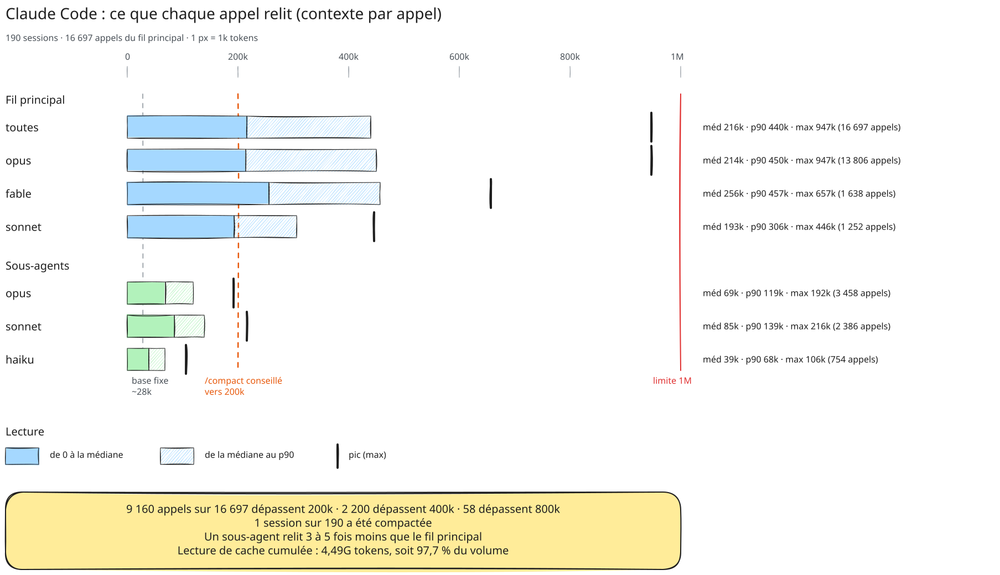

# Audit du contexte Claude Code

Combien de contexte chaque appel au modèle relit-il, et qu'est-ce qui le fait grossir ? Mesure faite sur les transcripts de 190 sessions d'un même projet, du 16 septembre au 19 octobre 2026.

<picture>
  <source media="(prefers-color-scheme: dark)" srcset="claude-context-audit/context-audit-dark.svg">
  
</picture>

Source modifiable : [context-audit.excalidraw](claude-context-audit/context-audit.excalidraw) (à glisser sur excalidraw.com). Image à partager : [context-audit.png](claude-context-audit/context-audit.png).

## Ce qu'on mesure

À chaque appel (une réponse ou un tour d'outil), le modèle relit tout le contexte accumulé depuis le début de la session. **Contexte d'un appel = entrée + lecture de cache + écriture de cache.** C'est une taille instantanée, plafonnée par la fenêtre du modèle (1M ici), pas un cumul.

Sans `/compact`, ce contexte ne fait que grossir au fil de la session. Le **médian** d'une session correspond donc à peu près au contexte à mi-parcours, et son **max** au contexte en fin de session.

## Contexte par appel

**Fil principal**

| | appels | min | médiane | moyenne | p90 | max |
|---|--:|--:|--:|--:|--:|--:|
| **toutes** | 16 697 | 27.7k | 216k | 245k | 440k | 947k |
| opus | 13 806 | 27.7k | 214k | 246k | 450k | 947k |
| fable | 1 638 | 47.2k | 256k | 271k | 457k | 657k |
| sonnet | 1 252 | 55.4k | 193k | 198k | 306k | 446k |

**Sous-agents**

| | appels | min | médiane | moyenne | p90 | max |
|---|--:|--:|--:|--:|--:|--:|
| opus | 3 458 | 10.1k | 68.6k | 71.3k | 119k | 192k |
| sonnet | 2 386 | 14.0k | 84.5k | 89.0k | 139k | 216k |
| haiku | 754 | 9.1k | 38.5k | 40.1k | 67.5k | 106k |
| fable | 32 | 12.1k | 81.7k | 101k | 209k | 211k |

**Seuils.** Sur 16 697 appels du fil principal, 9 160 dépassent 200k, 2 200 dépassent 400k et 58 dépassent 800k. Une seule session sur 190 a été compactée.

**Pic par session.** Médiane 238k, p90 480k, max 947k.

**Pour mémoire, le cache cumulé.** La lecture de cache totalise 4,49G tokens (97,7 % du volume), l'écriture de cache 86,8M.

## Les 10 sessions au plus gros pic

| # | modèle | ctx max | ctx médian | appels | sujet |
|--:|---|--:|--:|--:|---|
| 1 | opus | 947k | 477k | 386 | Fin d'un arbre + bug de webview |
| 2 | opus | 749k | 421k | 409 | Remplacer initialize.sh par devcontainer.json |
| 3 | opus | 726k | 393k | 293 | Release-check échoué v1.5.0 |
| 4 | opus | 724k | 461k | 249 | Migration d'un arbre |
| 5 | fable | 657k | 441k | 162 | Migration des arbres vers devcontainer-v3 |
| 6 | opus | 654k | 395k | 379 | Serveur Discord |
| 7 | opus | 605k | 335k | 325 | Reprise d'un cours |
| 8 | opus | 594k | 366k | 266 | Deux releases + une migration |
| 9 | opus | 583k | 359k | 271 | Daemon de notification, version 0.5.0 |
| 10 | opus | 566k | 355k | 185 | Suivi post-publication 1.6.0 |

## Ce que ça montre

1. **Personne ne compacte.** Une session sur 190, alors que plus de la moitié des appels (9 160) dépassent 200k. Un `/compact` vers 200k ramènerait chacun de ces appels à une fraction de sa taille.
2. **Les sessions enchaînent plusieurs sujets.** Les n°1 et n°8 traitent deux ou trois tâches à la suite : la dernière relit tout le contexte des précédentes. Un `/clear` entre deux sujets repart de la base.
3. **Les sessions sont longues.** Le top 10 compte 160 à 410 appels. Au-delà d'environ 150, un passage de relais vers une nouvelle session coûte moins cher que de continuer.
4. **Les sous-agents relisent 3 à 5 fois moins.** Médiane 40–85k, contre 216k pour le fil principal. Une exploration large (beaucoup de fichiers, de logs, de recherches) gagne à leur être confiée.
5. **Chaque appel part de ~28k.** C'est le contexte fixe : prompt système, CLAUDE.md, définitions d'outils et de serveurs MCP. L'alléger réduit les 16 697 appels d'un coup.
6. **Avoir 1M ne veut pas dire qu'il faut le remplir.** Le pic atteint 947k. Une fenêtre de 200k forcerait les compactages du point 1.

## Méthode

- **Source :** les transcripts `~/.claude/projects/<projet>/*.jsonl` et ceux des sous-agents (`<session>/subagents/*.jsonl`).
- **Comptage :** chaque réponse compte une fois. Claude Code écrit une réponse sur plusieurs lignes (réflexion, texte, appel d'outil) et recopie le même bloc `usage` sur chacune, d'où un dédoublonnage par `message.id`. Sans lui, les chiffres sont gonflés de 2 à 3×.
- **Modèles :** regroupés par famille (opus, fable, sonnet, haiku), toutes versions confondues.
- **Limite :** les sessions dont le transcript a été supprimé ne sont pas comptées.

## Lancer l'audit sur un autre projet

Le script [token-audit.js](claude-context-audit/token-audit.js) n'a aucune dépendance (Node seulement) et ne fait que lire les transcripts. Lance-le depuis la racine du projet :

```sh
node token-audit.js
```

Il lit `~/.claude/projects/<slug du dossier courant>/`. S'il ne trouve pas ce dossier, il liste ceux qui existent ; passe alors le bon chemin en argument :

```sh
node token-audit.js ~/.claude/projects/<dossier>
```

Il sort en Markdown :

- les tableaux ci-dessus ;
- les seuils ;
- le total cache ;
- le classement des 25 sessions au plus gros pic, avec leur sujet.
