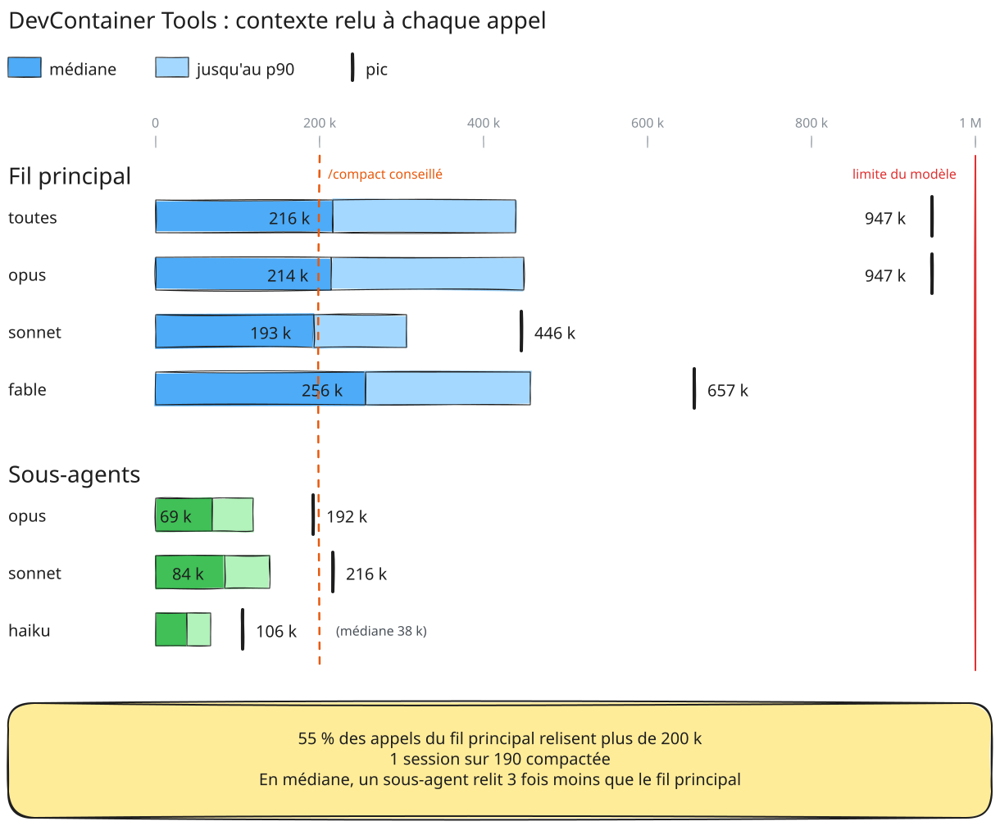

# Audit du contexte Claude Code — DevContainer Tools

Combien de contexte chaque appel au modèle relit-il, et qu'est-ce qui le fait grossir ? Mesure faite sur les transcripts de 190 sessions du projet DevContainer Tools, du 16 septembre au 19 octobre 2026.

<picture>
  <source media="(prefers-color-scheme: dark)" srcset="context-chart-dark.svg">
  
</picture>

Images à partager (dark) : [le diagramme](context-chart.png) et [le tableau](context-table.png). Sources modifiables, à glisser sur excalidraw.com : [context-chart.excalidraw](context-chart.excalidraw), [context-table.excalidraw](context-table.excalidraw).

## Ce qu'on mesure

À chaque appel (une réponse ou un tour d'outil), le modèle relit tout le contexte accumulé depuis le début de la session. **Contexte d'un appel = entrée + lecture de cache + écriture de cache.** C'est une taille instantanée, plafonnée par la fenêtre du modèle (1M ici), pas un cumul.

Sans `/compact`, ce contexte ne fait que grossir au fil de la session. Le **médian** d'une session correspond donc à peu près au contexte à mi-parcours, et son **max** au contexte en fin de session.

## Les chiffres

| DevContainer Tools | Min | Médiane | Moyenne | p90 | Max |
|---|--:|--:|--:|--:|--:|
| Contexte max, 190 sessions | 28 k | **238 k** | 264 k | 480 k | 947 k |
| &emsp;dont opus, 149 sessions | 28 k | **229 k** | 258 k | 470 k | 947 k |
| &emsp;dont sonnet, 18 sessions | 58 k | **189 k** | 225 k | 380 k | 446 k |
| &emsp;dont fable, 28 sessions | 54 k | **309 k** | 324 k | 534 k | 657 k |
| Contexte par appel, fil principal (16 740 appels) | 28 k | **216 k** | 244 k | 439 k | 947 k |
| Contexte par appel, sous-agents (6 630 appels) | 9 k | **70 k** | 74 k | 127 k | 216 k |

**Contexte max** : le pic atteint par chaque session, dans le fil principal. Une session est rangée sous chaque famille de modèle qu'elle a utilisée dans le fil principal.

**Seuils.** 9 160 appels du fil principal dépassent 200 k, 2 200 dépassent 400 k et 58 dépassent 800 k. Une seule session sur 190 a été compactée.

## Les 10 sessions au plus gros contexte max

| # | modèle | ctx max | ctx médian | appels | sujet |
|--:|---|--:|--:|--:|---|
| 1 | opus | 947 k | 477 k | 386 | Fin d'un arbre + bug de webview |
| 2 | opus | 749 k | 421 k | 409 | Remplacer initialize.sh par devcontainer.json |
| 3 | opus | 726 k | 393 k | 293 | Release-check échoué v1.5.0 |
| 4 | opus | 724 k | 461 k | 249 | Migration d'un arbre |
| 5 | fable | 657 k | 441 k | 162 | Migration des arbres vers devcontainer-v3 |
| 6 | opus | 654 k | 395 k | 379 | Serveur Discord |
| 7 | opus | 605 k | 335 k | 325 | Reprise d'un cours |
| 8 | opus | 594 k | 366 k | 266 | Deux releases + une migration |
| 9 | opus | 583 k | 359 k | 271 | Daemon de notification, version 0.5.0 |
| 10 | opus | 566 k | 355 k | 185 | Suivi post-publication 1.6.0 |

## Ce que ça montre

1. **Personne ne compacte.** Une session sur 190, alors que plus de la moitié des appels (9 160) dépassent 200 k. Un `/compact` vers 200 k ramènerait chacun de ces appels à une fraction de sa taille.
2. **Les sessions enchaînent plusieurs sujets.** Les n°1 et n°8 traitent deux ou trois tâches à la suite : la dernière relit tout le contexte des précédentes. Un `/clear` entre deux sujets repart de la base.
3. **Les sessions sont longues.** Le top 10 compte 160 à 410 appels. Au-delà d'environ 150, un passage de relais vers une nouvelle session coûte moins cher que de continuer.
4. **Les sous-agents relisent 3 fois moins.** Médiane 70 k, contre 216 k pour le fil principal. Une exploration large (beaucoup de fichiers, de logs, de recherches) gagne à leur être confiée.
5. **Chaque appel part de ~28 k.** C'est le contexte fixe : prompt système, CLAUDE.md, définitions d'outils et de serveurs MCP. L'alléger réduit tous les appels d'un coup.
6. **Avoir 1M ne veut pas dire qu'il faut le remplir.** Le pic atteint 947 k. Une fenêtre de 200 k forcerait les compactages du point 1.

## Méthode

- **Source :** les transcripts `~/.claude/projects/<projet>/*.jsonl` et ceux des sous-agents (`<session>/subagents/*.jsonl`).
- **Comptage :** chaque réponse compte une fois. Claude Code écrit une réponse sur plusieurs lignes (réflexion, texte, appel d'outil) et recopie le même bloc `usage` sur chacune, d'où un dédoublonnage par `message.id`. Sans lui, les chiffres sont gonflés de 2 à 3×.
- **Modèles :** regroupés par famille (opus, fable, sonnet, haiku), toutes versions confondues.
- **Limite :** les sessions dont le transcript a été supprimé ne sont pas comptées.
