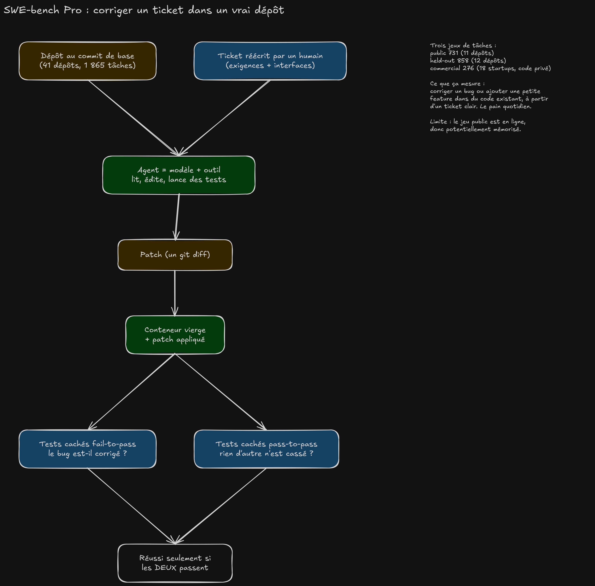
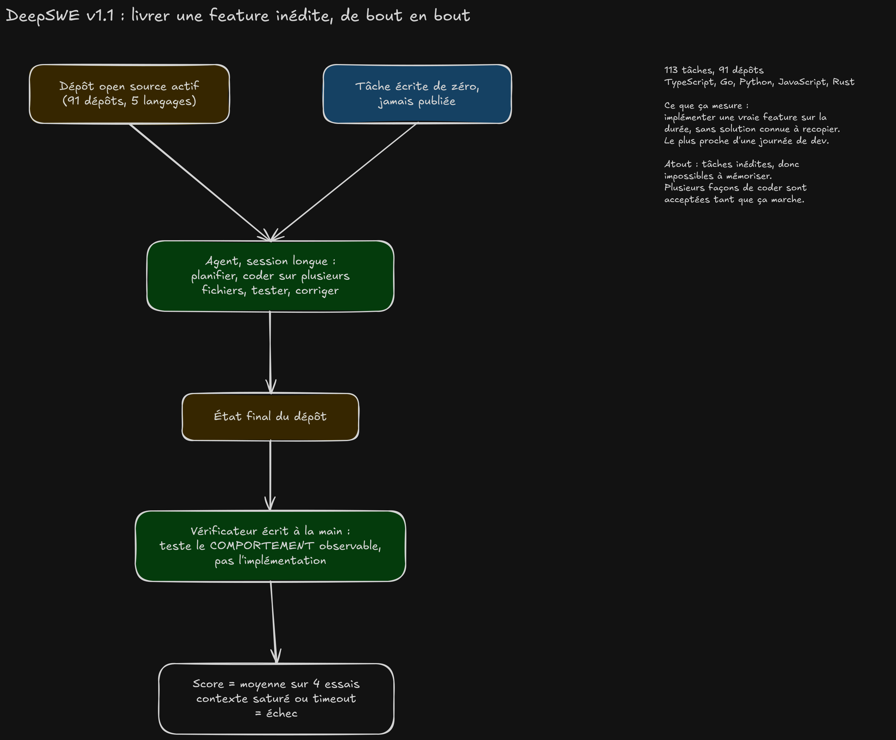
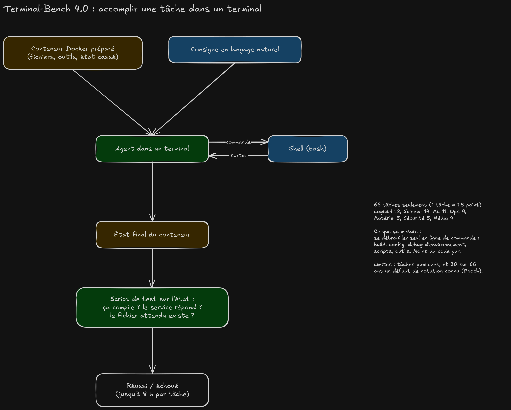

# Benchmarks de code : SWE-bench Pro, DeepSWE, Terminal-Bench

Trois benchmarks reviennent dans toutes les comparaisons de modèles pour le
code. Ils ne mesurent pas la même chose : un modèle peut briller sur l'un et
décrocher sur l'autre. Ce guide explique ce que fait chacun, en concret, et
lequel regarder selon le travail qu'on confie à l'agent.

Chiffres d'octobre 2026, relevés via des agrégateurs (benchlm, llm-stats,
Vals.ai) et non vérifiés un à un à la source.

## En une phrase

| Benchmark | La question posée à l'agent | Équivalent dans ta journée |
|---|---|---|
| **SWE-bench Pro** | « Voici un ticket et le dépôt, livre le patch. » | Corriger un bug ou ajouter une petite feature décrite dans une issue |
| **DeepSWE v1.1** | « Voici une feature jamais vue, implémente-la. » | Une vraie tâche de plusieurs heures, sur plusieurs fichiers |
| **Terminal-Bench 4.0** | « Voici une machine et une consigne, débrouille-toi. » | Faire passer un build, configurer un service, débugger un environnement |

## SWE-bench Pro : corriger un ticket

- **Entrée** : un dépôt figé à un commit, et un ticket qu'un humain a
  réécrit pour qu'il soit clair (exigences, interfaces attendues).
- **Sortie** : un patch (`git diff`), rien d'autre.
- **Notation** : le patch est appliqué dans un conteneur vierge, puis deux
  séries de tests cachés tournent. Les *fail-to-pass* échouaient avant et
  doivent passer (le bug est corrigé). Les *pass-to-pass* passaient déjà et
  doivent toujours passer (rien n'est cassé). Il faut les deux.
- **Volume** : 1 865 tâches sur 41 dépôts (applications métier, services
  B2B, outils de dev), en trois jeux : public (731), held-out (858) et
  commercial (276, code privé de startups).

**En concret** : « l'export CSV plante quand un champ contient un
point-virgule, corrige ». Le ticket est précis, le périmètre est borné, des
tests existent ou peuvent s'écrire.

**Limites** : le jeu public est en ligne, donc un modèle a pu l'apprendre.
Plusieurs versions coexistent (Pro, Pro V2) et leurs scores ne se comparent
pas : vérifier laquelle est citée.

## DeepSWE v1.1 : livrer une feature inédite

- **Entrée** : un dépôt open source actif et une tâche écrite de zéro pour
  le benchmark, jamais publiée dans le dépôt.
- **Travail** : une session longue. L'agent doit comprendre le code
  existant, planifier, modifier plusieurs fichiers, tester, corriger.
- **Notation** : un vérificateur écrit à la main teste le comportement
  observable (le programme fait-il ce qui est demandé ?), pas une
  implémentation précise. Toute solution qui marche est acceptée. Chaque
  modèle passe les 113 tâches 4 fois et on fait la moyenne. Saturer le
  contexte ou dépasser le temps compte comme un échec.
- **Volume** : 113 tâches, 91 dépôts, 5 langages (TypeScript, Go, Python,
  JavaScript, Rust).

**En concret** : « ajoute la reprise des téléchargements interrompus au
client HTTP ». Il faut lire l'architecture, toucher au transport, au cache
et aux tests, et tenir sur la durée.

**Atout** : les tâches n'existent nulle part ailleurs, donc impossible de les
avoir mémorisées. C'est le plus représentatif du travail de dev réel, et
celui qui pénalise un contexte trop court.

## Terminal-Bench 4.0 : se débrouiller dans un shell

- **Entrée** : un conteneur Docker préparé (fichiers, outils, souvent un
  état cassé) et une consigne en langage naturel.
- **Travail** : l'agent n'a qu'un terminal. Il lance des commandes, lit la
  sortie, recommence, jusqu'à 8 heures par tâche.
- **Notation** : un script de test inspecte l'état final du conteneur : le
  binaire compile, le service répond, le fichier attendu existe.
- **Volume** : 66 tâches. Logiciel 18, Science 14, ML 11, Ops 9, Matériel 5,
  Sécurité 5, Média 4.

**En concret** : « ce projet ne compile plus depuis la mise à jour de la
toolchain, répare le build », « monte un serveur qui répond sur le port
8080 avec un certificat valide ». Plus proche de l'admin et du DevOps que
de l'écriture de code.

**Limites** : avec 66 tâches, une tâche vaut 1,5 point et la marge d'erreur
est d'environ ±6 points. Epoch AI a relevé un défaut de notation sur 30
tâches, et les tâches sont publiques. Le score dépend aussi beaucoup de
l'outil qui pilote l'agent.

## Comparaison

| | SWE-bench Pro | DeepSWE v1.1 | Terminal-Bench 4.0 |
|---|---|---|---|
| Nombre de tâches | 1 865 | 113 | 66 |
| Ce qu'on rend | un patch | l'état du dépôt | l'état du conteneur |
| Vérification | tests cachés existants | vérificateur de comportement | script sur l'état final |
| Durée d'une tâche | courte | longue | courte à très longue |
| Risque de mémorisation | moyen (jeu public) | faible (tâches inédites) | moyen (tâches publiques) |
| Précision du score | bonne (beaucoup de tâches) | moyenne | faible (±6 points) |
| Sensible au contexte long | peu | beaucoup | moyennement |

## Scores d'octobre 2026

| Modèle | SWE-bench Pro | DeepSWE v1.1 | Terminal-Bench 4.0 | Où il tourne |
|---|---|---|---|---|
| Claude Opus 5.5 | 89,9 | 74,2 | 65,2 | cloud |
| Claude Sonnet 5.5 | 81,3 | — | 64,1 | cloud |
| Claude Fable 5.1 | 81,2 | 67,4 | 58,1 | cloud |
| DeepSeek V4.1 Flash 1017 | — | 77,0 ¹ | 42,3 ¹ | 256 Go minimum, 2 bits |
| GLM-5.3-Flash | — | 63,4 | 35,8 | 256 Go en 4 bits, 128 Go en 3 bits |
| Qwen3.8-Flash-Next | 62,5 ¹ | 58,7 ¹ | — | 128 Go en 4 bits |
| Qwen3.8-27B | 61,7 ¹ | 42,2 ¹ | — | 32 Go et plus |

¹ Chiffre annoncé par l'éditeur du modèle, pas reproduit par un tiers.

Le SWE-bench Pro d'Opus et celui de Qwen viennent peut-être de versions
différentes du benchmark : l'écart de 27 points est à prendre avec
prudence.

## Lequel regarder

- **Agent qui traite des tickets ou des PR courtes** : SWE-bench Pro.
- **Agent à qui on confie une feature entière** : DeepSWE. C'est le plus
  fiable des trois pour juger un modèle de code, parce que ses tâches sont
  inédites.
- **Agent qui travaille dans un environnement** (devcontainer, CI,
  Docker, scripts, configuration) : Terminal-Bench, en gardant sa marge
  d'erreur en tête.

Aucun des trois ne remplace un essai sur ses propres tâches : 10 à 20
vraies tâches de son dépôt, passées à chaque modèle candidat, disent plus
que n'importe quel classement.

## Sources

- [SWE-bench Pro, article](https://arxiv.org/pdf/2509.16941) et
  [classement Scale](https://labs.scale.com/leaderboard/swe_bench_pro)
- [DeepSWE, article](https://arxiv.org/pdf/2607.07946) et
  [dépôt](https://github.com/datacurve-ai/deep-swe)
- [Epoch AI sur DeepSWE](https://epoch.ai/benchmarks/deepswe)
- [Terminal-Bench 4.0, annonce](https://www.tbench.ai/news/terminal-bench-4-0)
- [Epoch AI sur Terminal-Bench 4.0](https://epoch.ai/benchmarks/terminal-bench-4/review)
- [Vals.ai, Terminal-Bench 4.0](https://www.vals.ai/benchmarks/terminal-bench-4)
- [benchlm, DeepSWE](https://benchlm.ai/benchmarks/deepswe)
- [benchlm, Fable 5.1 contre Opus 5.5](https://benchlm.ai/compare/claude-fable-5-1-vs-claude-opus-5-5)

Les schémas se régénèrent avec
[generate.mjs](coding-benchmarks/generate.mjs) (commandes en tête du
fichier).
